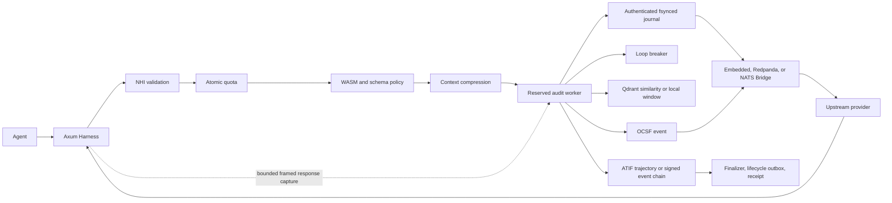

# Architecture

## Request flow

Production routes reserve bounded worker capacity before mutating quotas. Chat effects gate on a durable in-flight response marker before the upstream call, and MCP tool effects gate on a MAC-authenticated durable intent file before the upstream call, so a crash between authorization and effect always leaves crash-recovery evidence for the reconciler. The corresponding OCSF audit event is queued to the worker pool and published asynchronously (the request path does not block on broker `publish`); the durable local records — response marker and tool intent — are what the recovery scan reasons about. Synchronous quota, WASM, and compression work runs on Tokio's blocking pool when the request body is larger than 16 KiB, when a session or principal token budget is configured (`budget.max_tokens` or `principal_budget`), or when identity validation is configured; small requests with none of these run inline. Provider responses have a pre-reserved capture slot. Non-SSE responses are bounded and validated before delivery; SSE uses a bounded byte-oriented decoder.

Receipt signing and ATIF serialization remain off the request path. Worker overload fails before quota mutation and is counted in `pv_events_dropped_total`.

## Crates

- `pv-core`: identifiers, time, token estimates, digests, metrics.
- `pv-events`: OCSF agent event model and validation.
- `pv-atif`: ATIF v1.0-v1.7 reader, strict v1.7 writer, atomic persistence.
- `pv-receipts`: RFC 8785 canonicalization, hash chains, Ed25519 receipts.
- `pv-state`: atomic counters and multi-dimensional budgets, memory and Redis.
- `pv-bridge`: EventBus, embedded log, Kafka/Redpanda, NATS JetStream.
- `pv-identity`: EdDSA/HS256 NHI validation, delegation, JWKS refresh.
- `pv-compress`: auditable, idempotent context reduction.
- `pv-loopdetect`: hash or ONNX embeddings, circuit breaker, Qdrant sink.
- `pv-sandbox`: JSON-RPC parsing, JSON Schema, WASM policy. The crate also exports a native allow/deny tool-list type (`NativePolicy`) that is library-only. The daemon enforces JSON Schema and WASM policies from its configuration, plus the allowlist, schema, guardrail and transform rules pushed from the console (`pv_sandbox::pushed`).
- `pv-redact`: sensitive-data redaction for persisted audit payloads (built-in and custom regex patterns, JSON pointer paths); it never touches the traffic forwarded to the model.
- `pv-harness`: proxy, routes, workers, sessions, reconciliation.
- `pv-cli`: operational commands and load generation.

## Session lifecycle

A session is opened on first use and assigned `signed` or `unsigned` once. Close first blocks new work, drains accepted worker jobs, then:

- Signed: verifies the authenticated event journal, snapshots the event-chain head, and signs one receipt in `spawn_blocking`.
- Unsigned: snapshots, validates, atomically writes, and parent-fsyncs ATIF v1.7 without consuming retry state.
- Promotion: validates persisted ATIF, hashes it, and signs one idempotent retroactive receipt.
- Receipt and close events use deterministic fsynced outboxes with persisted broker acknowledgments.

Tool forwarding holds a session lease through bounded response capture and completion auditing. JSON-RPC ids back durable execution claims; uncertain crash outcomes are never re-executed automatically. Shutdown bounds HTTP drain, worker drain, and OTLP flush independently.

**Spool retention:** the ATIF spool (`atif_spool_dir`) has no *default*
retention — every unsigned artifact (plus its provenance sidecar and
close marker), every archived prior incarnation of a recycled session
id, and every receipt is kept indefinitely as audit evidence. Set
`atif_retention_days = N` (config.rs refuses `0`) to opt into the
built-in hourly sweep (`Finalizer::prune_sealed_atif`, started from
`proofvisord`'s `main.rs`; also exposed as `pvctl spool-prune`); only sealed
(ATIF + receipt) pairs older than `N` days are eligible. Receipts and
`.archived-*` collision-incarnation files are never retention targets
— manage them externally. Unbounded spool growth also grows the
reconciler's periodic scan cost, so pruning is an operational
requirement for long-lived, high-churn deployments, not merely a
disk-space concern.

## Console policy push

The daemon never calls the hosted console. `pvctl console-sync --watch
--pull-policies`, running on the same host, downloads the organization's
policy bundle and writes it to the file named by `policy_bundle_file`.
The daemon loads that file at boot, checks it for changes at a fixed
interval, and compiles each new bundle into rules that replace the
previous set as a whole. Budget, allowlist, schema, rate, guardrail and
transform policies are enforced when their body is the JSON spec;
free-text guardrail and transform policies are reported as unsupported.
Pushed rules can only add restrictions. After each attempt the daemon
writes `<policy_bundle_file>.status.json`, which lists the policies it
applied and the ones it could not apply, and `pvctl` reports that file
to the console.

The hosted console and its API are a separate Node.js (Fastify) service:
the API is in `server/` and the browser app is in `docs/app/`.

## Portability

The manifest declares topics, partitions, retention, cold storage, and JSON Schema references. Embedded provisioning copies and compiles referenced schemas. Kafka verifies partitions and `retention.ms`; NATS configures stream age. Secured endpoints are environment-driven: `PV_KAFKA_CA_FILE` plus `PV_KAFKA_SASL_USERNAME`/`PV_KAFKA_SASL_PASSWORD` (mechanism from `PV_KAFKA_SASL_MECHANISM`: `SCRAM-SHA-256` default, `SCRAM-SHA-512`, or `PLAIN`; credentials are refused without TLS) for Kafka/Redpanda, `PV_NATS_CA_FILE` plus `PV_NATS_USER`/`PV_NATS_PASSWORD` for NATS. Cold writes use deterministic object keys plus a local durable retry outbox (`PV_COLD_OUTBOX_DIR` overrides its location; network backends default to the CWD-relative `data/cold-outbox`, the embedded broker to `<bridge_data_dir>/cold-outbox`), independently of broker acknowledgment; `s3://` targets (feature `cold-store-aws`) take standard `AWS_*` credentials.
